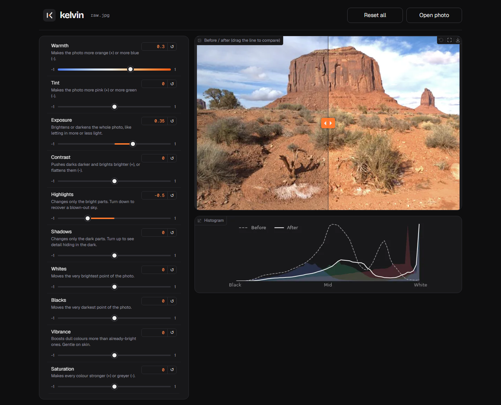

# Kelvin

An AI photo editor that edits like a person. It moves the same sliders a human editor would (exposure, shadows, highlights, warmth…), and it tells you *why* it moved them. You get a better photo and learn how editing works.

## Why this exists
Most people don't know how to make a photo look its best. Editing apps give you 20 sliders but no idea which ones to move. Kelvin's AI looks at the photo (and its histogram, the brightness graph) and sets the sliders the way a professional would.

**Does it already exist?** Partly. Lightroom's "Auto" button sets sliders but never explains itself. Imagen AI and Aftershoot copy a pro's style, but they're paid and closed. A 2018 research paper ("Exposure", Hu et al.) did the slider idea as a demo. Our twist: **it explains every change, it's open, and you can pick a style.**

## The key decision: the AI moves sliders, it doesn't redraw the photo
- You can see and adjust what it did.
- Each slider has a meaning, so it can explain itself.
- It can't invent fake details in your photo.
- It's a much smaller AI, so it's easier to train.

## How the AI will learn (step 3)
We use the **MIT-Adobe FiveK** dataset: 5,000 photos, each edited by 5 professionals. The loop:
1. Show the AI an unedited photo.
2. It guesses slider values.
3. Our editor ([kelvin/editor/ops.py](kelvin/editor/ops.py)) applies them.
4. Compare with how the expert edited it.
5. Nudge the guesses closer. Repeat thousands of times.

Step 5 only works because the editor is written in PyTorch, which can work out how each slider affected the result.

## Roadmap
- [x] **Step 1:** Editor with sliders + live histogram (no AI yet)
- [x] **Step 2:** Rule-based "Auto" button: hand-written rules set the sliders and explain each change. This is the score to beat.
- [x] **Step 3:** First AI, trained on FiveK (Expert C), 4,500 photos to learn from and 500 to test
- [x] **Step 4:** AI sets the sliders in the app, with a one-line reason per change
- [ ] **Step 5:** Extras: style picker (Experts A–E), learn *your* style, RAW files, Lightroom export

## Getting started
You need Python 3.11 or newer.

```bash
python -m venv .venv
# Windows:      .venv\Scripts\activate
# Mac / Linux:  source .venv/bin/activate
pip install -r requirements.txt

python app.py          # open the link it prints, upload a photo, play with the sliders or press Auto
python -m kelvin.data.prepare_fivek   # once: download the FiveK photos (~6 GB)
python -m kelvin.model.train          # once: train the AI (~25 min on a laptop); Auto uses it from then on
python -m pytest       # run the automatic checks
```

## Put it online
```bash
hf auth login              # once: paste a "write" token from huggingface.co/settings/tokens
python -m kelvin.deploy    # uploads the app and the trained AI to a free Hugging Face Space
```
Open the `https://<you>-kelvin.hf.space` link it prints. To install Kelvin as an app, tap **Add to Home Screen** on a phone, or click the install icon in your browser's address bar on a computer. It then opens in its own window with the Kelvin icon.

## Project layout
| File | What it is |
|---|---|
| [kelvin/editor/params.py](kelvin/editor/params.py) | The list of sliders, with plain-English descriptions |
| [kelvin/editor/ops.py](kelvin/editor/ops.py) | The editing maths: one function per slider |
| [kelvin/editor/histogram.py](kelvin/editor/histogram.py) | Draws the brightness graph |
| [kelvin/auto/rules.py](kelvin/auto/rules.py) | The first Auto button: rules that measure the photo, set sliders, and say why |
| [kelvin/auto/ai.py](kelvin/auto/ai.py) | Auto with the trained AI, plus a one-line explanation per slider |
| [kelvin/model/](kelvin/model/) | The AI (net.py) and how it's trained (train.py) |
| [kelvin/data/](kelvin/data/) | Downloads the FiveK photos and serves them for training |
| [kelvin/eval/](kelvin/eval/) | Scores any method against the expert's edits |
| [kelvin/ui/tokens.py](kelvin/ui/tokens.py) | The "Darkroom" design system: every colour and font, by name |
| [kelvin/ui/theme.py](kelvin/ui/theme.py) | Turns those tokens into the app's look (Gradio theme + CSS) |
| [app.py](app.py) | The web app (built with Gradio) |
| [kelvin/deploy.py](kelvin/deploy.py) | Puts the app online as a Hugging Face Space |
| [tests/](tests/) | Automatic checks that each slider behaves sensibly |



Every slider goes from **-1 to +1**, and **0 means "no change"**. Keeping them all on one scale makes the AI's job simpler.
